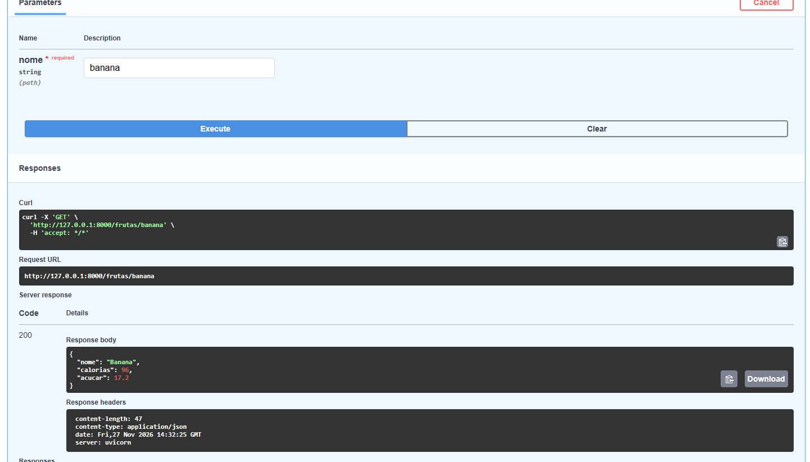
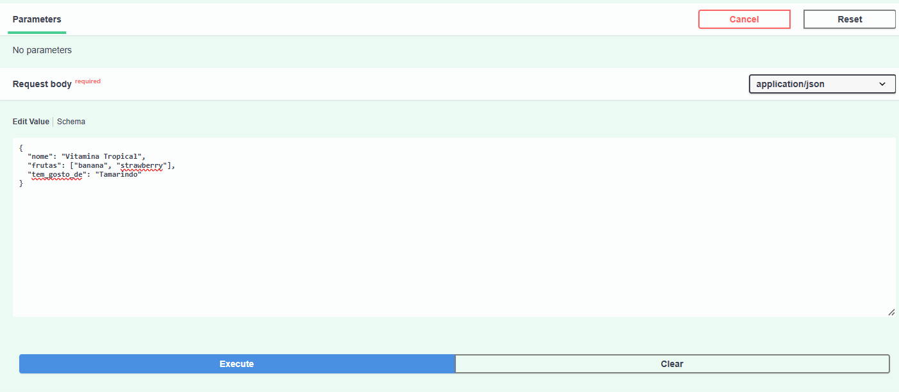
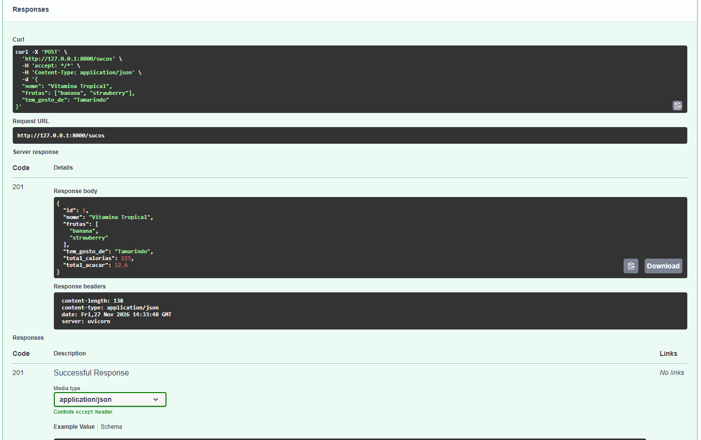
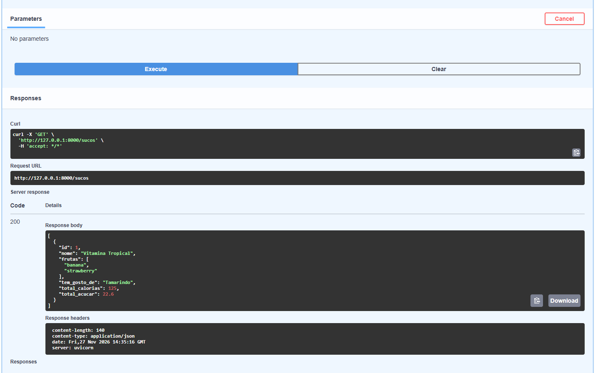
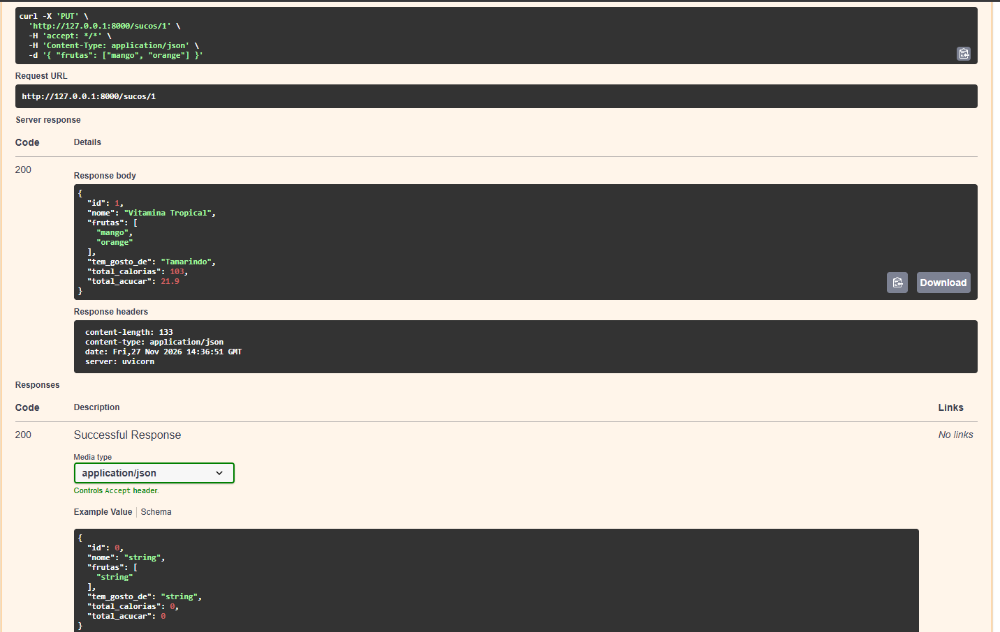
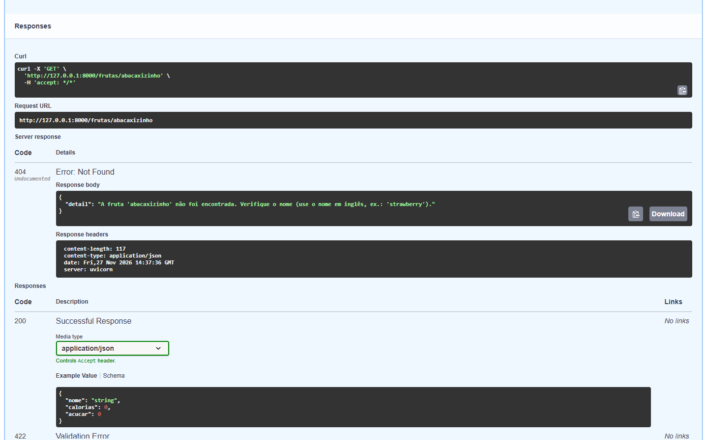

# 🍹 API Casa de Sucos

API desenvolvida em **Python + FastAPI** para uma Casa de Sucos. A aplicação consulta a API pública
[Fruityvice](https://www.fruityvice.com/) para obter as informações nutricionais das frutas e calcula
o total de **calorias** e **açúcar** de cada suco cadastrado.

> Para os cálculos, considera-se **100 g de cada fruta** informada (os dados da Fruityvice já são por 100 g).

## Endpoints

| Método | Rota | Descrição |
|---|---|---|
| `GET` | `/frutas/{nome}` | Consulta uma fruta na Fruityvice e retorna nome, calorias e açúcar |
| `POST` | `/sucos` | Cadastra um suco e calcula seus valores nutricionais |
| `GET` | `/sucos` | Lista todos os sucos cadastrados |
| `PUT` | `/sucos/{id}` | **(Bônus)** Atualiza as frutas de um suco e recalcula os valores |

### Tratamento de erros

| Código | Quando acontece |
|---|---|
| `404` | Fruta não encontrada na Fruityvice, ou suco com o `id` informado não existe |
| `422` | Corpo da requisição inválido (ex.: lista de frutas vazia) |
| `502` | A Fruityvice retornou um erro inesperado |
| `503` | Não foi possível conectar à Fruityvice |

> ⚠️ Os nomes das frutas devem estar **em inglês** (ex.: `banana`, `strawberry`, `mango`, `orange`).

## Como executar

```bash
# 1. Criar e ativar o ambiente virtual
python -m venv venv
venv\Scripts\activate        # Windows
# source venv/bin/activate   # Linux/Mac

# 2. Instalar as dependências
pip install -r requirements.txt

# 3. Iniciar o servidor
uvicorn main:app --reload
```

Acesse o Swagger em: **http://127.0.0.1:8000/docs**

## Exemplos de uso

### `GET /frutas/banana`
```json
{
  "nome": "Banana",
  "calorias": 96.0,
  "acucar": 17.2
}
```

### `POST /sucos`
Requisição:
```json
{
  "nome": "Vitamina Tropical",
  "frutas": ["banana", "strawberry"],
  "tem_gosto_de": "Tamarindo"
}
```
Resposta (`201 Created`):
```json
{
  "id": 1,
  "nome": "Vitamina Tropical",
  "frutas": ["banana", "strawberry"],
  "tem_gosto_de": "Tamarindo",
  "total_calorias": 125.0,
  "total_acucar": 22.6
}
```

### `GET /sucos`
```json
[
  {
    "id": 1,
    "nome": "Vitamina Tropical",
    "frutas": ["banana", "strawberry"],
    "tem_gosto_de": "Tamarindo",
    "total_calorias": 125.0,
    "total_acucar": 22.6
  }
]
```

### `PUT /sucos/1` (bônus)
Requisição:
```json
{ "frutas": ["mango", "orange"] }
```
Resposta:
```json
{
  "id": 1,
  "nome": "Vitamina Tropical",
  "frutas": ["mango", "orange"],
  "tem_gosto_de": "Tamarindo",
  "total_calorias": 103.0,
  "total_acucar": 21.9
}
```

### Erro: fruta não encontrada (`GET /frutas/abacaxizinho`)
Resposta (`404 Not Found`):
```json
{
  "detail": "A fruta 'abacaxizinho' não foi encontrada. Verifique o nome (use o nome em inglês, ex.: 'strawberry')."
}
```

## Evidências dos testes no Swagger

Os prints dos testes realizados no Swagger estão na pasta [`evidencias/`](evidencias/).

| Teste | Print |
|---|---|
| Consulta de fruta |  |
| Cadastro de suco (requisição) |  |
| Cadastro de suco (resposta) |  |
| Listagem de sucos |  |
| Atualização de suco (bônus) |  |
| Fruta não encontrada (404) |  |

## Observações

- Os sucos ficam armazenados **em memória**, então são apagados quando o servidor é reiniciado.
- Estrutura do projeto:
  ```
  aula_14/
  ├── main.py
  ├── requirements.txt
  ├── README.md
  ├── .gitignore
  └── evidencias/
  ```
